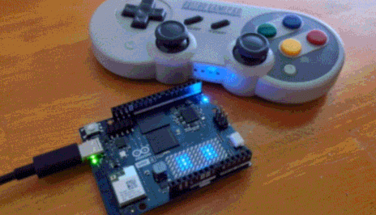

# RobotRover

Drive an Arduino UNO Q robot (two wheels + a 4-servo arm) from an Android phone, a
desktop browser, or an 8BitDo SF30 Pro gamepad paired straight to the board, all over
Bluetooth. The board's LED matrix shows what the robot is doing.
Everything here is open source, needs no accounts, and runs offline once installed.

**Full documentation:** [RobotRover_System_Guide.pdf](RobotRover_System_Guide.pdf) covers the
design, every component seam, how the system was built, installation, testing status,
security and troubleshooting. This README is the quick reference.

<p align="center">
  
  <br>
  <em>The UNO Q showing the robot's face on its LED matrix, with the paired 8BitDo SF30 Pro.</em>
</p>

<p align="center">
  
  <br>
  <em>The Android app, connected, with Forward held (mockup drawn from the app's layout, before
  the Power off robot button was added below "Robot says").</em>
</p>

```
Phone app / desktop  --Bluetooth LE------>  relay (Python)  --arduino-router-->  sketch  -->  motors, servos, LED matrix
8BitDo gamepad       --Bluetooth Classic-->  board/              UNO Q Linux        RobotRover.ino
android/, desktop/                           UNO Q Linux side                       UNO Q microcontroller
```

The UNO Q's Bluetooth radio is on its Linux side, so a small Python relay there
receives commands and passes them to the sketch through Arduino's Bridge. A paired
gamepad's left stick, D-pad and buttons become the same commands in the same relay.

| Path | What it is | Written in | Builds into | Runs on |
|---|---|---|---|---|
| `RobotRover.ino`, `RobotMatrix.h` | The sketch: commands, wheels, servos, battery gauge, Bridge registration, LED matrix face and icons | C++, ~1,010 lines | Firmware via `arduino-cli` (~126 KB) | UNO Q microcontroller (STM32U585) |
| `board/` | Bluetooth relay (`robot_ble_bridge.py`, which also handles Power off), gamepad support (`robot_gamepad.py`, `pair-gamepad.sh`), plus two ways to install it | Python, ~820 lines | Nothing; copied to the board | UNO Q Linux side |
| `android/` | Android app, no third-party libraries | Kotlin, ~700 lines, plus ~980 lines of XML screens and icons | `RobotRover.apk` via Gradle (~860 KB) | Android 8+ phone |
| `desktop/` | Same controller for a PC browser, with keyboard, console, demo mode and matrix preview | JavaScript, ~715 lines | Nothing; `serve.py` serves it | Chrome or Edge on a PC |
| `docs/build_pdf.py` | Generates the PDF guide (and the pinout image's SVG) | Python, ~1,530 lines | `RobotRover_System_Guide.pdf` | Any PC with Python 3 |
| `RobotRover_System_Guide.pdf` | Full documentation | – | – | – |
| `images/` | The GIF above, plus the app mockup, board pinout and wiring diagram used here and in the PDF, with the pinout and wiring SVG sources | – | – | – |

*Line counts are rounded, from release 1.3. Section 10 of the PDF has the full code map.*

**Not in this repo:** build outputs (the APK and firmware), the relay's bundled Python packages
(download command in install step 2), Arduino's `arduino-router` (comes with the board),
`android/local.properties` (specific to each PC), and the HTML used to render the app mockup.

---

## Install

Install in this order. Each step ends with a check.

### 1. Sketch (microcontroller)

1. Arduino IDE 2 → **Boards Manager** → install **Arduino Q Boards**.
2. **Library Manager** → install **Arduino_RouterBridge** and **Adafruit PWM Servo Driver Library**.
   (`Arduino_LED_Matrix` comes with the board package.)
3. Select **Arduino UNO Q** and upload `RobotRover.ino`, or from this folder:

```bash
arduino-cli compile -b arduino:zephyr:unoq .
```

```bash
arduino-cli upload -b arduino:zephyr:unoq -p COM13 .
```

(Use your board's port.) **Check:** the LED matrix shows a blinking face, and `pos` in the
Serial Monitor (line ending "New Line") answers with the joint angles.

**Battery gauge:** once the 20k / 10k divider is wired to A0 (see [Wiring](#wiring)), set
`BATTERY_SENSE = true` in `RobotRover.ino` and upload again. Compare `batt` with a multimeter on
the pack and adjust `BATT_CAL` until they agree. Until then `batt` answers "battery sensing off".

### 2. Bluetooth relay (board's Linux side)

**Option 1: offline over USB.** Works even if the board has no internet.
Needs `adb` from Android platform-tools.

1. On the PC, download the relay's five Python packages built for the board
   (aarch64, Python 3.13) and unzip each `.whl` into `robot-ble/lib/` (a wheel is a zip file):

```bash
python -m pip download --no-deps --only-binary=:all: --dest wheels --platform manylinux2014_aarch64 --platform manylinux_2_28_aarch64 --python-version 3.13 --implementation cp --abi cp313 --abi none bless==0.3.0 bleak==3.0.2 dbus-fast==5.2.0 dbus-next==0.2.3 msgpack==1.2.3
```

2. Copy everything to the board and start the relay at boot (runs as the normal `arduino` user):

```bash
adb shell "mkdir -p ~/robot-ble"
```

```bash
adb push robot-ble/lib /home/arduino/robot-ble/
```

```bash
adb push board/robot_ble_bridge.py board/robot_gamepad.py board/run.sh board/keepalive.sh board/pair-gamepad.sh /home/arduino/robot-ble/
```

```bash
adb shell "chmod +x ~/robot-ble/*.sh && echo '@reboot /home/arduino/robot-ble/keepalive.sh' | crontab -"
```

```bash
adb shell "cd ~/robot-ble && setsid nohup ./keepalive.sh >/dev/null 2>&1 </dev/null &"
```

(The crontab line replaces the `arduino` user's crontab, which is empty on a fresh board.)

3. **Set a password for the `arduino` user.** A fresh board's password is marked expired, and cron
   skips the `@reboot` job until it's changed, so the relay won't start at boot. In `adb shell` on
   the board, run Arduino's own tool, type the new password and press Enter (it doesn't ask for
   the old one, and needs no sudo password):

```bash
sudo /usr/local/bin/arduino-passwd
```

   Check with `chage -l arduino`: "Password expires" should say `never`.

4. **Allow Power off** (optional, for the app's Power off button). In `adb shell` on the board, add
   a sudoers rule that allows only that one command (it asks for the password from step 3):

```bash
echo 'arduino ALL=(root) NOPASSWD: /usr/bin/systemctl halt' | sudo tee /etc/sudoers.d/robot-poweroff
```

```bash
sudo chmod 440 /etc/sudoers.d/robot-poweroff && sudo visudo -c
```

**Option 2: standard install (board has internet).** Copy the `board` folder to the board
and run `bash setup.sh`. It uses apt and pip, installs to `/opt/robot-ble`, and runs the
relay as a root systemd service (`robot-ble-bridge`). It asks for the sudo password, so set
one first (item 3 above). Running as root, the relay can power the board off without the
sudoers rule. With this install the commands in this README change:

- Instead of `cd ~/robot-ble && ./run.sh ...`, use
  `sudo /opt/robot-ble/venv/bin/python /opt/robot-ble/robot_ble_bridge.py ...`
  (`--send pos`, `--gamepad-test`, `--reset-mcu`).
- Pair the gamepad with `/opt/robot-ble/pair-gamepad.sh`.
- The log is `journalctl -u robot-ble-bridge`, not `relay.log`; restart the relay with
  `sudo systemctl restart robot-ble-bridge`.

**Check** (Option 1 paths shown):

```bash
adb shell "cd ~/robot-ble && ./run.sh --send pos"
```

It should print `base 90 shoulder 90 elbow 90 gripper 30 speed 180`, and
`~/robot-ble/relay.log` should say `Advertising as 'RobotRover'`.

**After a reboot:** a Linux-only reboot leaves the microcontroller running but registered with
the old router, so the sketch can't be reached. The relay notices this (it waits 20 s after
starting), restarts the sketch through Arduino's `/opt/openocd/bin/arduino-reset.sh`, and logs
`sketch is back`. To do it by hand: `adb shell "cd ~/robot-ble && ./run.sh --reset-mcu"`.

To update the relay after editing `board/robot_ble_bridge.py` or `board/robot_gamepad.py`, push
the files and stop the running copy. `keepalive.sh` restarts it with the new code within a few
seconds:

```bash
adb push board/robot_ble_bridge.py board/robot_gamepad.py /home/arduino/robot-ble/ && adb shell "pkill -f '[r]obot_ble_bridge.py'"
```

Don't drive while uploading a sketch: a command that arrives mid-upload finds the sketch missing
and makes the relay reset the microcontroller.

(In Git Bash on Windows, put `MSYS_NO_PATHCONV=1` in front of `adb push`, or the board path
gets rewritten into a Windows path.)

### 3. Android app

Build it with Android Studio (**Build → Build APK(s)**), or without Android Studio:

1. Get JDK 17+, plus Android SDK **platform 35** and **build-tools 34.0.0** (the Android SDK
   License Agreement applies). Create `android/local.properties` pointing at the SDK, for
   example `sdk.dir=D\:\\Android\\Sdk`. This file is per-PC and not committed.
2. Build:

```bash
cd android && ./gradlew.bat assembleDebug
```

3. The APK is `android/app/build/outputs/apk/debug/RobotRover.apk` (a debug build, signed with
   this PC's automatic debug key, which is fine for installing it yourself). Plug the phone in with
   **File transfer** on and copy the APK to its **Download** folder.
4. On the phone: **Files → Downloads**, tap the APK, allow **Install unknown apps** for Files,
   tap **Install**, and choose **Install anyway** if Play Protect warns.

**Check:** open RobotRover → **Connect to robot** → allow Bluetooth. The status pill turns
green, and **Home** gets the reply `arm going home`.

### 4. Desktop controller (optional)

```bash
python desktop/serve.py
```

Opens `http://localhost:8765` (Chrome or Edge; listens on 127.0.0.1 only).
**Try demo** needs no hardware. **Connect to robot** uses the PC's Bluetooth.
Keyboard: W/A/S/D or arrows to drive (hold), Space stop, O / C gripper, H home.
The console sends any command, and the LED matrix card previews the board's display.

---

## Using it

- **Driving:** hold an arrow to drive, let go to stop. While held, the controller sends a
  400 ms drive pulse every 150 ms, so if the link drops the wheels stop on their own. The
  wheels ease up to speed over about 150 ms; stopping is instant.
- **Arm:** sliders move the joints. Open / Close / Home do what they say. The sliders in the
  app and on the desktop page follow the robot: they jump to its real positions when you
  connect and after the gamepad moves the arm. At power-on the
  servos go to home one at a time. The open gripper goes limp after 3 s idle (so it can be
  moved by hand) and holds again on its next command; the other joints always hold.
- **LED matrix:** each command flashes an icon (arrows, stop sign, joint dial, claw,
  house, speed bar, battery, `?`), then a face reacts for about 2.5 s (looks where you drove,
  squints when the gripper closes, smiles after home). When idle it blinks and glances
  around. The dial and claw follow the servos' real positions. When the battery is low a
  battery icon shows for 1 s every 8 s; when it's empty, a blinking empty battery replaces the face.
- **Battery empty:** below 6.6 V (for 3 s) the wheels stop and every command that moves
  something is refused with `battery empty 6.5 V, charge me`. Stop, `pos` and `batt` still work.
- **Power off:** with one battery, the main switch also cuts the board's Linux side. Tap
  **Power off robot** in the app (or **Power off** on the desktop page) first: the matrix
  shows a pulsing power symbol, then a sleeping face after 15 s. Then switch the battery off
  within about half a minute: on USB power the board starts up again by itself about 45 s
  after Power off (behavior on battery power is still to be checked).

### Gamepad (8BitDo SF30 Pro)

The controller pairs straight to the board's Bluetooth, so it drives the robot without a
phone. The phone keeps working alongside it.

**Pair it once:**

1. Switch the controller on in **D-input (Android) mode**: hold **Start + B**. (Switch mode
   won't work; the board lacks its driver.)
2. Hold **Pair** for 3 s until the lights blink quickly.
3. On the board, run the pairing script. It looks for up to 2 minutes, then pairs, trusts
   and connects the controller:

```bash
adb shell "cd ~/robot-ble && ./pair-gamepad.sh"
```

After that, switching the controller on in D-input mode connects it to the robot again,
and `relay.log` says `gamepad connected`. To see what each button sends:
`adb shell "cd ~/robot-ble && ./run.sh --gamepad-test"`. If a label is wrong, edit `BUTTONS`
at the top of `board/robot_gamepad.py`, push it again and restart the relay (the update
command in install step 2).

| Control | Does |
|---|---|
| Left stick | drive: up / down is speed, left / right steers (spins in place), diagonals curve; faster the further you push |
| Right stick | not used |
| D-pad left / right | base |
| D-pad up / down | shoulder |
| L2 / R2 | elbow down / up |
| A / B | gripper open / close |
| L / R | top speed down / up (the same speed the phone's arrows use; the app's slider follows) |
| X | battery icon on the matrix |
| Select | stop |
| Start (tap) | arm home |
| Hold Start + Select for 3 s | power off |

Driving uses the same safety rule as the phone: short pulses while the stick is pushed, a
stop when it's released, and a stop if the controller switches off or goes out
of range. While the gamepad is driving, the phone's drive buttons are ignored
until half a second after you let go; Stop works from either. For tank controls instead
(each stick's up / down drives one wheel), set `DRIVE_STYLE = "tank"` in `robot_gamepad.py`.

### Commands

The same commands work from the phone, the desktop console, the Serial Monitor, and `run.sh --send`
(one exception: `poweroff` typed in the Serial Monitor only puts the sketch in power-off mode;
it does not shut Linux down):

| Command | Does |
|---|---|
| `w` / `s` / `a` / `d` `[ms]` | forward / back / spin left / spin right (default 1 s, `0` = until stopped) |
| `m L R [ms]` | wheel speeds: left and right −255 to 255 (what the gamepad sends) |
| `x` or `stop` | stop wheels |
| `speed N` | wheel speed 0–255 |
| `base N`, `shoulder N`, `elbow N`, `grip N` | move a joint to N degrees (clamped to its limits) |
| `open`, `close`, `home` | gripper open / closed, whole arm to home |
| `pos` | report positions |
| `batt` | report the battery, e.g. `battery 7.62 V ok` |
| `poweroff` | shut the board down (the relay does it; needs the sudoers rule or the root install) |

The relay only forwards these commands. Anything else gets `rejected: ...`. While powering
off, commands that move something get `powering off`. From the Serial Monitor, `poweroff 0`
cancels a power-off.

## Hardware


*Pins used by RobotRover. The board is drawn to scale (68.6 × 53.3 mm) from Arduino's
published top view of the UNO Q; small parts are omitted and chip labels are approximate.*

| Part | Connection |
|---|---|
| Left motor | PWM D5, direction D7 / D8 (via TB6612FNG or L298N) |
| Right motor | PWM D6, direction D4 / D2 |
| PCA9685 servo board | I2C SDA / SCL, address 0x40 |
| Servos | channel 0 base, 1 shoulder, 2 elbow, 3 gripper |
| Battery | 2S Li-ion pack with BMS (7.4 V), through a main switch |
| Servo regulator | pack → 5 V switching regulator (5 A+, or 3 A for micro servos) → PCA9685 V+ |
| Board regulator | pack → 5 V buck-boost regulator (3 A) → UNO Q **5V** pin |
| Battery divider | 20k from the pack to **A0**, 10k from A0 to GND |

One battery powers everything; never power motors or servos from the UNO Q itself.
Connect all grounds together. The header pins are 3.3 V.

### Wiring


- **One battery, three branches.** After the main switch, the pack feeds the TB6612's VM
  directly (6–8.4 V; the TB6612's maximum is 13.5 V), the servo regulator (5 V into the
  PCA9685's V+), and the board regulator (5 V into the UNO Q's 5V pin).
- **Never power motors or servos from the UNO Q.** Its 5V pin is an input here, fed only by
  its own regulator.
- **Check polarity on the 5V pin.** Arduino's datasheet (rev 15 and later) allows powering
  the board through it but lists no reverse-polarity or over-voltage protection; keep it at
  4.5–5.5 V. USB-C can stay plugged in for uploads: the board joins its inputs through diodes.
- **The board regulator must be buck-boost**, so it keeps giving 5 V when motor surges sag the
  pack. The servo regulator must keep regulating down to a 6 V input.
- **Don't feed the pack into VIN.** VIN needs 7–24 V, and a 2S pack spends its last stretch below 7 V.
- **Shut down before switching off:** use Power off in the app and wait for the sleeping face.
- **All grounds connect together:** UNO Q, both TB6612 GND pins, PCA9685, both regulators,
  the pack's (−), and the bottom of the divider.
- **Battery divider:** 20k from the pack's + (after the switch, so it doesn't drain a parked
  robot) to A0, 10k from A0 to GND. 8.4 V reads 2.8 V at the pin.
- **Tie the TB6612's STBY to 3.3 V**, or it ignores every command.
- **Logic is 3.3 V:** TB6612 VCC and PCA9685 VCC come from the UNO Q's 3.3V pin.
- **Add a 470–1000 µF capacitor** across the servo board's V+ and GND.
- **Using an L298N instead?** ENA = D5, IN1 = D7, IN2 = D8, ENB = D6, IN3 = D4, IN4 = D2.
  Remove the ENA/ENB jumpers.
- **First power-up:** wheels off the ground, then try `w 500` and `base 90`.

## Status

Working end to end: the phone connects over Bluetooth and the relay, router, sketch and
LED matrix respond. On the board: every command including `batt` and `poweroff`, the
empty-battery and power-off lockouts, 300 rapid commands with no lost replies, and Power
off being refused cleanly without the sudoers rule. After `sudo reboot`, the relay starts by
itself and restarts the sketch, which answers about 31 s after boot. Power off halts Linux
and shows the sleeping face. The gamepad support drove the real relay and sketch through a
virtual SF30 Pro on the board, and the real SF30 Pro is paired, reconnects by itself, and its
D-pad and Start + Select work (arm targets and the matrix; no servos are wired yet).
**Not yet tested:** driving with its left stick and its A/B/X/L/R button labels, the phone and
gamepad at the same time (including the app's sliders following the gamepad), motors and
servos in the robot, whether the relaxed gripper saves current, wheels stopping when the link
drops, the battery gauge on a real pack, Power off on battery power, a cold start from the
battery switch, the LED matrix's brightness levels, and the desktop controller over real
Bluetooth. See Section 7 of the PDF.

## Troubleshooting

| Symptom | Check |
|---|---|
| App: "Robot not found" | Relay running? `tail ~/robot-ble/relay.log`. `bluetoothctl show` should say `Powered: yes`. On Android 11 or older, Location must be on. |
| Replies: `robot restarting, try again in a few seconds` | The relay found the sketch unregistered (usually after a reboot) and is restarting it. If it keeps happening, re-upload `RobotRover.ino`. |
| `run.sh --send`: `'robot' failed ... not available` | Same cause; `./run.sh --reset-mcu` restarts the sketch. If that doesn't help, re-upload `RobotRover.ino`. |
| Replies: `no answer from 'robot'` | Sketch stuck or rebooting. Check the Serial Monitor. |
| Matrix blank | Sketch not running. Re-upload. |
| "PCA9685 servo board not found" | SDA/SCL wiring, servo board power, shared ground. |
| A wheel runs backwards | Flip `LEFT_REVERSED` / `RIGHT_REVERSED` in the sketch. |
| Desktop: "This browser can't use Bluetooth" | Use Chrome or Edge, opened through `serve.py`. |
| Relay not running after a reboot | `journalctl -u cron` saying "expired password": set one with `arduino-passwd` (install step 2, item 3). |
| Replies: `battery empty ... charge me` | Charge the pack. Moves unlock once it reads 6.8 V or more. |
| `batt`: "battery not connected" | Pack switched off, or the divider isn't wired to A0. |
| Power off: "poweroff not allowed" | Add the sudoers rule (install step 2, item 4). |
| Board resets when the motors or servos start | Board regulator not buck-boost or too small, servo regulator too small, or grounds not shared. |
| Gamepad does nothing | `relay.log` should say `gamepad connected`. If not: switch it on in D-input mode (Start + B), or pair it again with `pair-gamepad.sh`. |
| Gamepad buttons do the wrong thing | Run `./run.sh --gamepad-test` and fix `BUTTONS` in `robot_gamepad.py`. |
| Phone's drive buttons don't work | The gamepad is driving; the phone gets the wheels back about 0.5 s after the left stick is released. |

Changing joint limits, home angles, Bluetooth UUIDs or timings? Several files must agree.
See "Values that must match across seams" in Section 4 of the PDF.

## Rebuilding the PDF guide

The PDF is generated from `docs/build_pdf.py`. After changing it, rebuild with:

```bash
pip install reportlab
```

```bash
python docs/build_pdf.py
```

It writes `RobotRover_System_Guide.pdf` in the repo root, using `images/app_mockup.png` and
`images/wiring.png`; every other figure is drawn by the script.

The two images in this README come from editable sources in the repo:

- `images/board_pinout.png`: `python docs/build_pdf.py --pinout-svg` writes
  `images/board_pinout.svg` from the PDF's own pinout drawing; render it at 3× (below).
- `images/wiring.png`: rendered from the hand-written `images/wiring.svg`.

To render them with Edge (the pinout at 3×, the wiring diagram at its own size):

```bash
msedge --headless=new --hide-scrollbars --force-device-scale-factor=3 --window-size=468,484 --screenshot=board_pinout.png file:///path/to/images/board_pinout.svg
```

```bash
msedge --headless=new --hide-scrollbars --force-device-scale-factor=1 --window-size=2299,1690 --screenshot=wiring.png file:///path/to/images/wiring.svg
```

## Security

Bluetooth LE here has no pairing or PIN, so anyone nearby could connect while the relay
runs. The relay only accepts the robot commands above, so nothing else on the board is
reachable. That includes Power off: anyone who can connect can shut the board down, the
same exposure as driving it. A drive time of `0` means "until stopped", so a command like `w 0`
keeps the wheels turning even if the link then drops; the apps and the gamepad never send it.
The relay treats any paired input device named like an 8BitDo controller as the gamepad;
`pair-gamepad.sh` switches pairing off again when it finishes. The sudoers rule allows `systemctl halt` and nothing else.
To stop the relay (Option 1 install):

```bash
adb shell "pkill -f '[k]eepalive.sh'; pkill -f '[r]obot_ble_bridge.py'"
```

The Android app has no internet permission, and the desktop page loads nothing from the internet.

## License

No license has been chosen yet. Add one before publishing if you want others to reuse the code.
