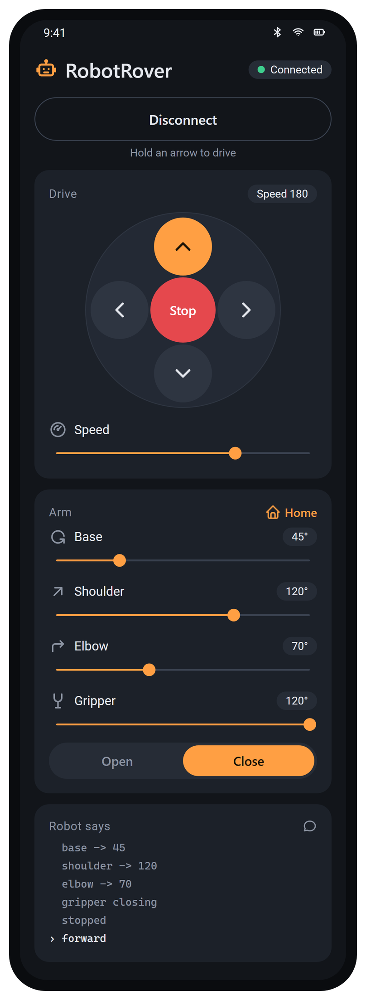
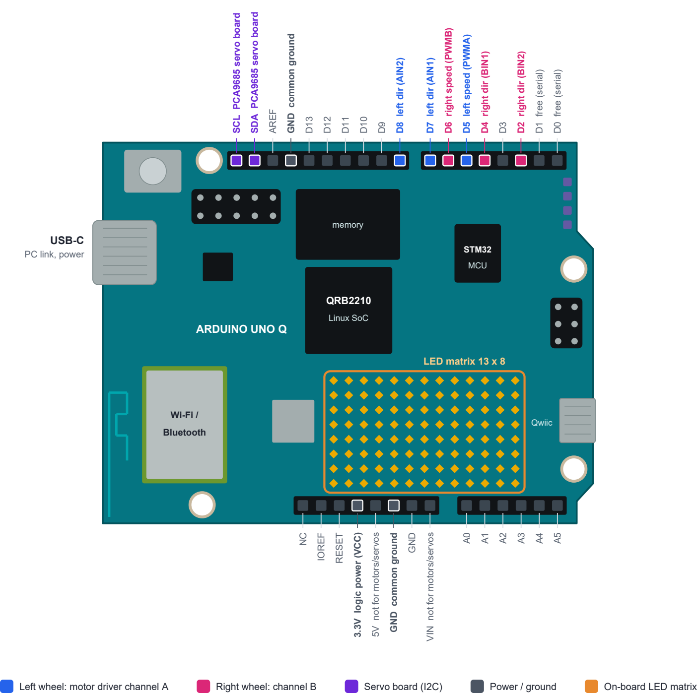
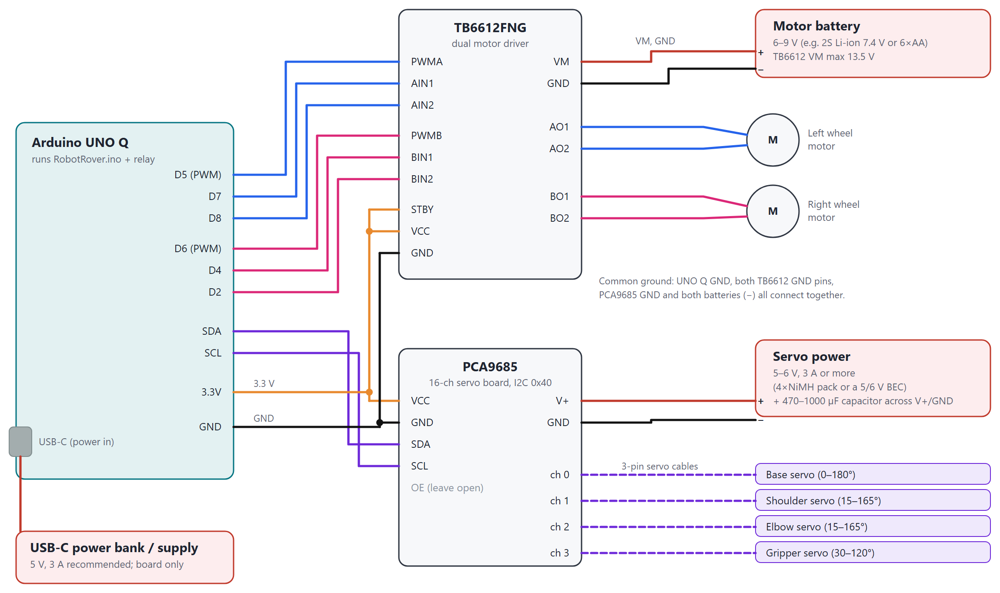

# RobotRover

Drive an Arduino UNO Q robot (two wheels + a 4-servo arm) from an Android phone or a
desktop browser over Bluetooth. The board's LED matrix shows what the robot is doing.
Everything here is open source, needs no accounts, and runs offline once installed.

**Full documentation:** [RobotRover_System_Guide.pdf](RobotRover_System_Guide.pdf) covers the
design, every component seam, how the system was built, installation, testing status,
security and troubleshooting. This README is the quick reference.

<p align="center">
  
  <br>
  <em>The Android app, connected, with Forward held (mockup drawn from the app's layout).</em>
</p>

```
Phone app / desktop  --Bluetooth LE-->  relay (Python)  --arduino-router-->  sketch  -->  motors, servos, LED matrix
android/, desktop/                      board/              UNO Q Linux        RobotRover.ino
                                        UNO Q Linux side                       UNO Q microcontroller
```

The UNO Q's Bluetooth radio is on its Linux side, so a small Python relay there
receives commands and passes them to the sketch through Arduino's Bridge.

| Path | What it is |
|---|---|
| `RobotRover.ino` | The sketch: commands, wheels, servos, Bridge registration |
| `RobotMatrix.h` | LED matrix icons and robot face (part of the sketch) |
| `board/` | Bluetooth relay (`robot_ble_bridge.py`) plus two ways to install it |
| `android/` | Android app (Kotlin, no third-party libraries) |
| `desktop/` | Same controller for a PC browser, with keyboard, console, demo mode and matrix preview |
| `RobotRover_System_Guide.pdf` | Full documentation |
| `images/` | App mockup, board pinout and wiring diagram used here and in the PDF |

---

## Install

Install in this order. Each step ends with a check.

### 1. Sketch (microcontroller)

1. Arduino IDE 2 → **Boards Manager** → install **Arduino Q Boards**.
2. **Library Manager** → install **Arduino_RouterBridge** and **Adafruit PWM Servo Driver Library**.
   (`Arduino_LED_Matrix` comes with the board package.)
3. Select **Arduino UNO Q** and upload `RobotRover.ino`, or from this folder:

```bash
arduino-cli compile -b arduino:zephyr:unoq .
```

```bash
arduino-cli upload -b arduino:zephyr:unoq -p COM13 .
```

(Use your board's port.) **Check:** the LED matrix shows a blinking face, and `pos` in the
Serial Monitor (line ending "New Line") answers with the joint angles.

### 2. Bluetooth relay (board's Linux side)

**Option A: offline over USB, no password.** Works even if the board has no internet.
Needs `adb` from Android platform-tools.

1. On the PC, download the relay's five Python packages built for the board
   (aarch64, Python 3.13) and unzip each `.whl` into `robot-ble/lib/` (a wheel is a zip file):

```bash
python -m pip download --no-deps --only-binary=:all: --dest wheels --platform manylinux2014_aarch64 --platform manylinux_2_28_aarch64 --python-version 3.13 --implementation cp --abi cp313 --abi none bless==0.3.0 bleak==3.0.2 dbus-fast==5.2.0 dbus-next==0.2.3 msgpack==1.2.3
```

2. Copy everything to the board and start the relay at boot (runs as the normal `arduino` user):

```bash
adb shell "mkdir -p ~/robot-ble"
```

```bash
adb push robot-ble/lib /home/arduino/robot-ble/
```

```bash
adb push board/robot_ble_bridge.py board/run.sh board/keepalive.sh /home/arduino/robot-ble/
```

```bash
adb shell "chmod +x ~/robot-ble/*.sh && echo '@reboot /home/arduino/robot-ble/keepalive.sh' | crontab -"
```

```bash
adb shell "cd ~/robot-ble && setsid nohup ./keepalive.sh >/dev/null 2>&1 </dev/null &"
```

(The crontab line replaces the `arduino` user's crontab, which is empty on a fresh board.)

**Option B: standard install (board has internet).** Copy the `board` folder to the board
and run `bash setup.sh`. It uses apt and pip, installs to `/opt/robot-ble`, and runs the
relay as a root systemd service (`robot-ble-bridge`). It asks for the sudo password.

**Check** (Option A paths shown):

```bash
adb shell "cd ~/robot-ble && ./run.sh --send pos"
```

It should print `base 90 shoulder 90 elbow 90 gripper 30 speed 180`, and
`~/robot-ble/relay.log` should say `Advertising as 'RobotRover'`.

To update the relay after editing `board/robot_ble_bridge.py`, push the file and stop the
running copy. `keepalive.sh` restarts it with the new code within a few seconds:

```bash
adb push board/robot_ble_bridge.py /home/arduino/robot-ble/ && adb shell "pkill -f '[r]obot_ble_bridge.py'"
```

### 3. Android app

Build it with Android Studio (**Build → Build APK(s)**), or without Android Studio:

1. Get JDK 17+, plus Android SDK **platform 35** and **build-tools 34.0.0** (the Android SDK
   License Agreement applies). Create `android/local.properties` pointing at the SDK, for
   example `sdk.dir=D\:\\Android\\Sdk`. This file is per-PC and not committed.
2. Build:

```bash
cd android && ./gradlew.bat assembleDebug
```

3. The APK is `android/app/build/outputs/apk/debug/app-debug.apk`. Plug the phone in with
   **File transfer** on and copy the APK to its **Download** folder.
4. On the phone: **Files → Downloads**, tap the APK, allow **Install unknown apps** for Files,
   tap **Install**, and choose **Install anyway** if Play Protect warns.

**Check:** open RobotRover → **Connect to robot** → allow Bluetooth. The status pill turns
green, and **Home** gets the reply `arm going home`.

### 4. Desktop controller (optional)

```bash
python desktop/serve.py
```

Opens `http://localhost:8765` (Chrome or Edge; listens on 127.0.0.1 only).
**Try demo** needs no hardware. **Connect to robot** uses the PC's Bluetooth.
Keyboard: W/A/S/D or arrows to drive (hold), Space stop, O / C gripper, H home.
The console sends any command, and the LED matrix card previews the board's display.

---

## Using it

- **Driving:** hold an arrow to drive, let go to stop. While held, the controller sends a
  400 ms drive pulse every 150 ms, so if the link drops the wheels stop on their own.
- **Arm:** sliders move the joints. Open / Close / Home do what they say.
- **LED matrix:** each command flashes an icon (arrows, stop sign, joint dial, claw,
  house, speed bar, `?`), then a face reacts for about 2.5 s (looks where you drove,
  squints when the gripper closes, smiles after home). When idle it blinks and glances
  around. The dial and claw follow the servos' real positions.

### Commands

The same commands work from the phone, the desktop console, the Serial Monitor, and `run.sh --send`:

| Command | Does |
|---|---|
| `w` / `s` / `a` / `d` `[ms]` | forward / back / spin left / spin right (default 1 s, `0` = until stopped) |
| `x` or `stop` | stop wheels |
| `speed N` | wheel speed 0–255 |
| `base N`, `shoulder N`, `elbow N`, `grip N` | move a joint to N degrees (clamped to its limits) |
| `open`, `close`, `home` | gripper open / closed, whole arm to home |
| `pos` | report positions |

The relay only forwards these commands. Anything else gets `rejected: ...`.

## Hardware



*Pins used by RobotRover. The board is drawn to scale (68.6 × 53.3 mm) from Arduino's
published top view of the UNO Q; small parts are omitted and chip labels are approximate.*

| Part | Connection |
|---|---|
| Left motor | PWM D5, direction D7 / D8 (via TB6612FNG or L298N) |
| Right motor | PWM D6, direction D4 / D2 |
| PCA9685 servo board | I2C SDA / SCL, address 0x40 |
| Servos | channel 0 base, 1 shoulder, 2 elbow, 3 gripper |

Power motors and servos from their own batteries, never from the UNO Q's 5 V pin, and
connect all grounds together. The header pins are 3.3 V.

### Wiring



- **Never power motors or servos from the UNO Q.** The board runs from a USB-C supply
  (Arduino specifies 5 V, 3 A); motors (6–9 V into VM) and servos (5–6 V, 3 A or more
  into V+) each get their own battery.
- **All grounds connect together:** UNO Q, both TB6612 GND pins, PCA9685, and both batteries' (−).
- **Tie the TB6612's STBY to 3.3 V**, or it ignores every command.
- **Logic is 3.3 V:** TB6612 VCC and PCA9685 VCC come from the UNO Q's 3.3V pin.
- **Add a 470–1000 µF capacitor** across the servo board's V+ and GND.
- **Using an L298N instead?** ENA = D5, IN1 = D7, IN2 = D8, ENB = D6, IN3 = D4, IN4 = D2.
  Remove the ENA/ENB jumpers.
- **First power-up:** wheels off the ground, then try `w 500` and `base 90`.

## Status

Working end to end: the phone connects over Bluetooth and the relay, router, sketch and
LED matrix respond. **Not yet tested:** motors and servos in the robot, the LED matrix's
brightness levels on real hardware, the desktop controller over real Bluetooth, and
relay autostart after a reboot. See Section 7 of the PDF.

## Troubleshooting

| Symptom | Check |
|---|---|
| App: "Robot not found" | Relay running? `tail ~/robot-ble/relay.log`. `bluetoothctl show` should say `Powered: yes`. On Android 11 or older, Location must be on. |
| Replies: `'robot' failed ... not available` | The sketch on the board is old or not running. Re-upload `RobotRover.ino`. |
| Replies: `no answer from 'robot'` | Sketch stuck or rebooting. Check the Serial Monitor. |
| Matrix blank | Sketch not running. Re-upload. |
| "PCA9685 servo board not found" | SDA/SCL wiring, servo board power, shared ground. |
| A wheel runs backwards | Flip `LEFT_REVERSED` / `RIGHT_REVERSED` in the sketch. |
| Desktop: "This browser can't use Bluetooth" | Use Chrome or Edge, opened through `serve.py`. |

Changing joint limits, home angles, Bluetooth UUIDs or timings? Several files must agree.
See "Values that must match across seams" in Section 4 of the PDF.

## Security

Bluetooth LE here has no pairing or PIN, so anyone nearby could connect while the relay
runs. The relay only accepts the robot commands above, so nothing else on the board is
reachable. To stop the relay (Option A install):

```bash
adb shell "pkill -f '[k]eepalive.sh'; pkill -f '[r]obot_ble_bridge.py'"
```

The Android app has no internet permission, and the desktop page loads nothing from the internet.

## License

No license has been chosen yet. Add one before publishing if you want others to reuse the code.
